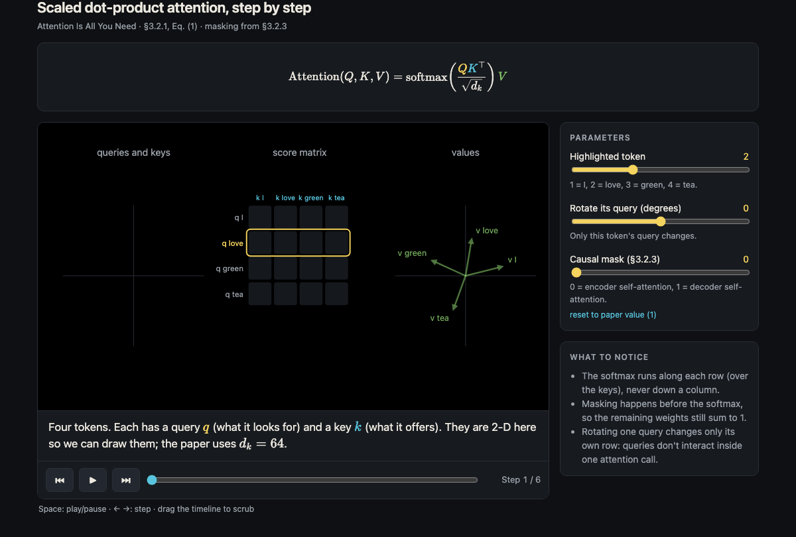

# Researcher Pal

Three [Claude Code](https://claude.com/claude-code) skills for working with research papers.

**[Instructions →](docs/INSTRUCTIONS.md)** · [File structure](docs/FILE-STRUCTURE.md)
