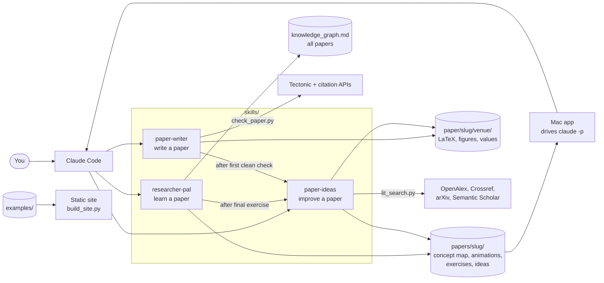
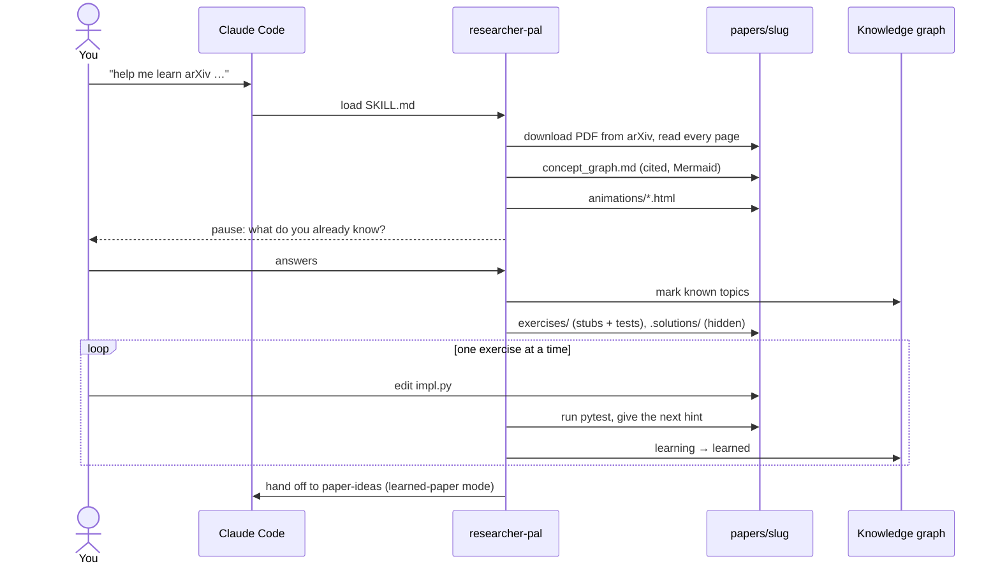

# System design

How Researcher Pal is put together. Back to the [README](../README.md) · [Instructions](INSTRUCTIONS.md) · [File structure](FILE-STRUCTURE.md)

## Overview

Researcher Pal is three skills that run inside Claude Code: researcher-pal teaches a paper, paper-writer helps
write one, and paper-ideas suggests improvements to either. Each skill is a Markdown instruction file plus
templates and small standard-library Python scripts for the checks that must be exact. Everything they produce
is plain files on disk; an optional Mac app and a static site are two ways to look at those files.

## Components

| Part | What it does | Where |
|---|---|---|
| **researcher-pal** | Eight steps: get and read the paper, write a cited concept graph, build animations, pause, write exercises with hidden solutions, tutor one at a time, final exercise. Keeps a cross-paper knowledge graph. | `skills/researcher-pal/` |
| **paper-writer** | Steps P1–P9: intake, venue rules, outline, figures and values from scripts, draft, citations, compile and check, revise, retarget to another venue. | `skills/paper-writer/` |
| **paper-ideas** | Gathers context, generates and grounds ideas, checks the literature, ranks and pauses; applies edits or runs experiments only when approved. Two modes: own draft, learned paper. | `skills/paper-ideas/` |
| **Paper checks** | Page limit, anonymity, unsourced numbers, TODOs, figures, regeneration against the data, citation verification. | `skills/paper-writer/scripts/check_paper.py` |
| **Literature search** | Keyword search over four free APIs, merged by identifier, cached on disk, with a guard that refuses queries quoting the draft. | `skills/paper-ideas/scripts/lit_search.py` |
| **Ideas report check** | Every idea card has its fields, the table matches the cards, cited IDs are verified records, links resolve. | `skills/paper-ideas/scripts/check_ideas.py` |
| **Templates and assets** | Concept graph, exercise and knowledge graph templates; animation player; venue profiles; figure style. | `skills/*/references/`, `skills/*/assets/` |
| **Mac app** | SwiftUI library of papers; runs the skills through the `claude` CLI and shows the outputs in tabs. | `app/` |
| **Static site** | Renders the example outputs into a browsable site. | `site/build_site.py` |
| **Checks** | One script for everything the repo can verify; CI runs the same one. | `tools/checks.sh`, `tests/`, `.github/workflows/ci.yml` |

## Main flows

**Learn a paper**

**Write a paper.** paper-writer reads the researcher's results, notes, code and drafts, pausing after intake
and after the outline. Every figure, table and in-text number is written by a script from the data
(`generated/values.tex`, `sources.md`). After compiling with Tectonic, `check_paper.py` must report no FAILs;
only then does it hand off to paper-ideas. Retargeting copies the venue folder and rebuilds against the new
template.

**From the Mac app.** *Study this paper* and *Suggest improvements* start `claude -p` in stream-JSON mode in
the paper's folder with a fixed prompt, a model, a permission mode and a spending cap. When a skill pauses to
ask, your answer resumes the same session.

## Data and storage

| Data | Where | Notes |
|---|---|---|
| A learned paper | `papers/<slug>/` in the current folder; `~/researcher-pal/papers/<slug>/` from the app | PDF, concept graph, animations, exercises, ideas. |
| Hidden solutions | `papers/<slug>/.solutions/` | Mirrors `exercises/`; shown only on request. |
| Knowledge graph | `~/researcher-pal/knowledge_graph.md` | One file for all papers; topics merged, status only moves forward. |
| A paper being written | `paper/<slug>/<venue>/` | Scripts shared across venues; one folder per venue. |
| Literature results | `ideas/literature/*.json`, `*.md` | Raw API records, the only IDs an ideas report may cite. |
| Search cache | `~/.cache/paper-ideas/lit_search` | Successes only, with an age limit. |
| App settings | `UserDefaults` | Model, permission mode, commands on or off, budget. |
| Examples | `examples/` | Two learning runs and one example paper, used by the site and the checks. |

## Design decisions

- **Instructions, not a program.** Skills are Markdown the agent follows, so they work on any paper in any
  field; the cost is that behaviour isn't deterministic. The parts that must be exact are scripts with tests.
- **Never invent.** Concept entries cite the paper and label anything else *not in paper*; papers use
  `\TODO{}` instead of guessing; citations and idea references must match a real API record.
- **Numbers come from data.** Values and tables are generated, and `--regenerate` rebuilds them to prove the
  committed paper still matches, restoring the folder afterwards.
- **Pause for people.** The skills stop after key steps and never apply an idea or run an experiment unasked.
- **Exercises are proven both ways.** Stubs must fail and reference solutions must pass, run in a temp copy.
- **The draft stays local.** Literature queries that quote the draft or run long are refused before sending.
- **No API key in the app.** It drives the installed CLI and its login, so there's no separate billing; the
  cost is depending on that CLI's flags and output format.
- **Standard library scripts.** No dependencies to install; Python 3.9 compatible.

## Testing

`tools/checks.sh` runs the unit tests in `tests/` (the literature guard, API parsers, caching and merging; bib
parsing, page counts, anonymity, unsourced numbers and regeneration in the paper checker; the ideas-report
checker), checks both example ideas reports, builds the site, runs the example exercises both ways, and
compiles both example papers and re-checks them against their data. CI runs it in three jobs; citation
checks are left out of CI because the APIs rate-limit. `evals/` records a one-off comparison of
researcher-pal against no skill on three unseen papers. The Mac app and the skills' prose aren't unit-tested.

## Limits

- Free literature APIs throttle, so searches may return only Crossref results.
- Only NeurIPS, ICML and ICLR have built-in venue profiles; others are read from the call for papers.
- The Mac app is ad-hoc signed and doesn't include paper-writer yet; a run can look stalled while a skill
  waits for your answer.
- The evaluation covered three papers and didn't exercise animations, tutoring or the knowledge graph.
- The example paper's notes and draft are made up; its results are from real runs.
