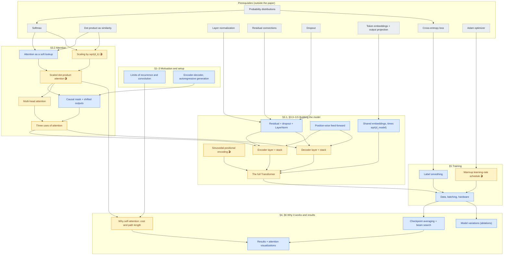

# Attention Is All You Need: concept graph

> **Source:** arXiv:1706.03762**v7** (2 Aug 2023), Vaswani, Shazeer, Parmar, Uszkoreit, Jones,
> Gomez, Kaiser, Polosukhin, NeurIPS 2017. Section, equation, table and figure numbers refer
> to this version.
> **Legend:** **not in paper** = common practice or inference, not stated by the authors.
> 🎬 = has an interactive animation.

## The paper in five lines

1. **Problem:** recurrent sequence models process tokens one at a time. That blocks parallel training and makes long-range dependencies hard to learn.
2. **Idea:** drop recurrence and convolution entirely and build the encoder and decoder from attention plus position-wise feed-forward layers.
3. **What's new:** scaled dot-product attention, multi-head attention, sinusoidal positional encodings, and the warmup learning-rate schedule that makes the model train.
4. **Result:** 28.4 BLEU on WMT14 English-German, more than 2 BLEU above the previous best (ensembles included), at a fraction of the training cost. It also transfers to constituency parsing.
5. **Watch out for:** masking, where LayerNorm and dropout go, the √d_k and √d_model scalings, and weight tying. Each gets one sentence in the paper and is easy to get wrong.

## Map

Arrows go from prerequisite to concept. Start from the grey nodes you don't know yet.

## Coverage

Every section, numbered equation, table and figure of the paper maps to at least one concept.

| Paper item | What it is | Concept(s) |
|---|---|---|
| Abstract, §1 | motivation, headline results | [rnn_limits](#rnn_limits-limits-of-recurrence-and-convolution), [results](#results-results-and-attention-visualizations) |
| §2 | ByteNet/ConvS2S path lengths, self-attention, memory networks | [rnn_limits](#rnn_limits-limits-of-recurrence-and-convolution), [why_self_attention](#why_self_attention-why-self-attention-cost-and-path-length) |
| §3 (intro) | encoder-decoder, auto-regressive decoding | [encoder_decoder](#encoder_decoder-encoder-decoder-and-autoregressive-generation) |
| Figure 1 | the model architecture | [transformer](#transformer-the-full-transformer) |
| §3.1 | encoder and decoder stacks, residual + LayerNorm, decoder masking | [sublayer](#sublayer-residual-connection-dropout-and-layernorm), [encoder_layer](#encoder_layer-encoder-layer-and-stack), [decoder_layer](#decoder_layer-decoder-layer-and-stack), [causal_mask](#causal_mask-causal-mask-and-shifted-outputs) |
| §3.2 | attention as a query/key/value mapping | [attention_fn](#attention_fn-attention-as-a-soft-lookup) |
| §3.2.1, Eq. (1) | scaled dot-product attention | [sdpa](#sdpa-scaled-dot-product-attention) |
| §3.2.1, footnote 4 | why dot products grow with d_k | [dk_scaling](#dk_scaling-scaling-by-the-square-root-of-d_k) |
| Figure 2 | diagrams of scaled dot-product and multi-head attention | [sdpa](#sdpa-scaled-dot-product-attention), [mha](#mha-multi-head-attention) |
| §3.2.2 (unnumbered MultiHead equation) | multi-head attention, h = 8, d_k = d_v = 64 | [mha](#mha-multi-head-attention) |
| §3.2.3 | encoder self-, decoder masked self-, encoder-decoder attention | [attention_uses](#attention_uses-three-uses-of-attention), [causal_mask](#causal_mask-causal-mask-and-shifted-outputs) |
| §3.3, Eq. (2) | position-wise feed-forward network, d_ff = 2048 | [ffn](#ffn-position-wise-feed-forward-network) |
| §3.4 | shared embedding and pre-softmax weights, scaling by √d_model | [shared_embeddings](#shared_embeddings-embeddings-weight-tying-and-scaling) |
| §3.5 (unnumbered PE equations) | sinusoidal positional encoding | [pos_encoding](#pos_encoding-sinusoidal-positional-encoding) |
| Table 1 | complexity, sequential operations, path length per layer type | [why_self_attention](#why_self_attention-why-self-attention-cost-and-path-length) |
| §4 | why self-attention; restricted attention; interpretability | [why_self_attention](#why_self_attention-why-self-attention-cost-and-path-length), [results](#results-results-and-attention-visualizations) |
| §5.1, §5.2 | WMT14 data, vocabularies, 25k-token batches, 8×P100 schedule | [training_setup](#training_setup-data-batching-and-hardware) |
| §5.3, Eq. (3) | Adam settings and the warmup schedule | [lr_schedule](#lr_schedule-warmup-learning-rate-schedule) |
| §5.4 | residual dropout, label smoothing | [sublayer](#sublayer-residual-connection-dropout-and-layernorm), [label_smoothing](#label_smoothing-label-smoothing) |
| §6.1, Table 2 | translation results, checkpoint averaging, beam search | [results](#results-results-and-attention-visualizations), [inference](#inference-checkpoint-averaging-and-beam-search) |
| §6.2, Table 3 | model variations | [model_variations](#model_variations-model-variations) |
| §6.3, Table 4 | English constituency parsing | [results](#results-results-and-attention-visualizations) |
| §7 | conclusion and future work | [results](#results-results-and-attention-visualizations) |
| Figures 3–5 (appendix) | attention visualizations | [results](#results-results-and-attention-visualizations) |

## Concepts (dependency order)

### probability_distribution: Probability distributions

- **Kind:** prerequisite
- **Source:** used in §3.2.1 (attention weights) and §5.4 (label smoothing's target distribution)
- **Depends on:** none

**Intuition.** A list of non-negative numbers that sum to 1, one per possible outcome. Attention weights are a
distribution over keys for each query, and the model's output is a distribution over the vocabulary at each position.

$$
p_k \ge 0, \qquad \sum_k p_k = 1
$$

**Nuances and gotchas.**
- "Sums to 1 along which axis?" is the question behind most attention and loss bugs.

### softmax: Softmax

- **Kind:** prerequisite
- **Source:** used in §3.2.1 Eq. (1) and §3.4
- **Depends on:** [probability_distribution](#probability_distribution-probability-distributions)

**Intuition.** Turns any list of real scores into a probability distribution. Bigger scores
get exponentially more mass. Adding a constant to every score changes nothing, but
multiplying all scores by a large number makes the output nearly one-hot.

$$
\mathrm{softmax}(z)_i = \frac{e^{z_i}}{\sum_j e^{z_j}}
$$

**Nuances and gotchas.**
- The gradient is $\partial s_i / \partial z_j = s_i(\delta_{ij} - s_j)$. When one $s_i \approx 1$, every entry is near 0.
  That's the "extremely small gradients" in [dk_scaling](#dk_scaling-scaling-by-the-square-root-of-d_k).
- A score of $-\infty$ gets exactly 0 probability, which is how masking works.

### dot_product: Dot product as similarity

- **Kind:** prerequisite
- **Source:** used in §3.2.1

**Intuition.** $q \cdot k = \lVert q\rVert\,\lVert k\rVert \cos\theta$: large when the vectors point the same way. Stacking
queries as rows of $Q$ and keys as rows of $K$, the product $QK^\top$ computes every query-key dot product
in one matrix multiply.

**Nuances and gotchas.**
- Unlike cosine similarity, the dot product grows with vector length and dimension. That's the root of
  [dk_scaling](#dk_scaling-scaling-by-the-square-root-of-d_k).

### layer_norm: Layer normalization

- **Kind:** prerequisite
- **Source:** [1], used in §3.1

**Intuition.** Rescales each position's feature vector to mean 0 and variance 1, then applies a learned
scale $\gamma$ and shift $\beta$. It normalizes over features, not over the batch, so it works the same at any batch size.

$$
\mathrm{LN}(x) = \gamma \odot \frac{x - \mu(x)}{\sqrt{\sigma^2(x) + \epsilon}} + \beta,\quad \mu, \sigma^2 \text{ taken over the } d_{model} \text{ features}
$$

**Nuances and gotchas.**
- The paper doesn't give $\epsilon$. PyTorch's default is 1e-5; tensor2tensor used 1e-6. **not in paper**

### residual: Residual connections

- **Kind:** prerequisite
- **Source:** [11], used in §3.1

**Intuition.** Output = input + change. Each layer only has to learn a correction, and gradients get a
direct path through the identity, so deep stacks can train.

**Nuances and gotchas.**
- The residual add requires input and output to have the same size, which is why every sub-layer in
  the Transformer outputs $d_{model} = 512$.

### dropout: Dropout

- **Kind:** prerequisite
- **Source:** [33], used in §5.4

**Intuition.** During training, zero each activation with probability $P_{drop}$ and scale the survivors by
$1/(1-P_{drop})$. The network can't rely on any single unit. Turn it off at evaluation.

### token_embed: Token embeddings and output projection

- **Kind:** prerequisite
- **Source:** used in §3.4

**Intuition.** An embedding is a lookup table $E \in \mathbb{R}^{V \times d}$: token $t$ becomes row $E_t$. The output side
does the reverse: a linear map from $d$ to $V$ logits, then a softmax over the vocabulary.

### cross_entropy: Cross-entropy loss

- **Kind:** prerequisite
- **Source:** used implicitly in §5.4
- **Depends on:** [probability_distribution](#probability_distribution-probability-distributions)

**Intuition.** $-\log p(\text{correct token})$, averaged over tokens. It's small when the model puts high probability on the right answer.
Perplexity (Table 3) is $e^{\text{cross-entropy}}$.

### adam: Adam optimizer

- **Kind:** prerequisite
- **Source:** [20], used in §5.3

**Intuition.** Gradient descent with a per-parameter step size, adapted from running averages of the gradient
(momentum, $\beta_1$) and of its square ($\beta_2$).

**Nuances and gotchas.**
- The paper uses $\beta_2 = 0.98$ instead of the usual 0.999, which makes the second-moment estimate adapt faster.

### rnn_limits: Limits of recurrence and convolution

- **Kind:** core
- **Source:** §1, §2
- **Depends on:** none

**Intuition.** An RNN computes $h_t = f(h_{t-1}, x_t)$, so position $t$ waits for position $t-1$. Training can't be
parallelized within a sequence, and a signal from token 1 to token 50 passes through 49 steps.
Convolutional models (ByteNet, ConvS2S) parallelize, but connecting distant positions still takes many layers.

**Nuances and gotchas.**
- In §2 the number of operations between two positions grows "linearly for ConvS2S and logarithmically for
  ByteNet". The Transformer makes it constant, at the cost of "reduced effective resolution due to averaging",
  which multi-head attention is meant to counteract.

**Check yourself.** Why does a shorter path between positions make long-range dependencies easier to *learn*,
not just to compute?

### encoder_decoder: Encoder-decoder and autoregressive generation

- **Kind:** core
- **Source:** §3 (intro)
- **Depends on:** none

**Intuition.** The encoder reads the whole source sentence $(x_1, \dots, x_n)$ into continuous vectors
$z = (z_1, \dots, z_n)$. The decoder then writes the output $(y_1, \dots, y_m)$ one token at a time, feeding its own previous
outputs back in as input.

**Nuances and gotchas.**
- In training, the decoder is fed the *true* previous tokens (teacher forcing), so all positions are
  predicted in parallel. Generation is still sequential. The paper describes this through the "offset by one
  position" remark in §3.1 rather than by name.

### attention_fn: Attention as a soft lookup

- **Kind:** core
- **Source:** §3.2
- **Depends on:** [softmax](#softmax-softmax), [dot_product](#dot_product-dot-product-as-similarity)

**Intuition.** Think of a dictionary where every key partly matches your query. Instead of returning one value,
you return a blend of all values, weighted by how well each key matches.

$$
\mathrm{out}(q) = \sum_i \alpha_i v_i, \qquad \alpha_i = \frac{\exp(\mathrm{compat}(q, k_i))}{\sum_j \exp(\mathrm{compat}(q, k_j))}
$$

**Nuances and gotchas.**
- Queries, keys and values are three *roles*, not three kinds of data. In self-attention all three come from the same sequence.
- The compatibility function is the design choice. Additive attention [2] uses a small feed-forward network;
  this paper uses a scaled dot product.

**Check yourself.** If every key is identical, what does attention return for any query?

### dk_scaling: Scaling by the square root of d_k

- **Kind:** novel
- **Source:** §3.2.1 (last paragraph), footnote 4; evidence in Table 3 rows (B)
- **Depends on:** [softmax](#softmax-softmax), [dot_product](#dot_product-dot-product-as-similarity)
- **Animation:** [animations/dk_scaling.html](animations/dk_scaling.html)
- **Exercise:** `exercises/01_scaled_dot_product_attention/` (scaling test)

**Intuition.** Dot products of random high-dimensional vectors are *big*: their spread grows like $\sqrt{d_k}$. Big
scores push the softmax into a near one-hot regime where its gradients vanish. Dividing by $\sqrt{d_k}$ brings
the spread back to about 1, whatever the dimension.

$$
q \cdot k = \sum_{i=1}^{d_k} q_i k_i, \qquad q_i, k_i \overset{iid}{\sim} (0, 1) \;\Rightarrow\; \mathbb{E}[q\cdot k] = 0,\ \ \mathrm{Var}[q \cdot k] = d_k
$$

| Symbol | Meaning | Shape |
|---|---|---|
| $q, k$ | one query, one key | $(d_k)$ |
| $d_k$ | key/query dimension (64 in the base model) | scalar |

**Nuances and gotchas.**
- The paper states this as a suspicion ("We suspect…"), not a proven fact. The evidence is that additive
  attention beats *unscaled* dot-product attention at large $d_k$ [3].
- The unit-variance assumption is idealized, since real queries and keys are learned projections. The point is the
  *growth rate*, not the exact constant.
- Dividing by $\sqrt{d_k}$ is a softmax temperature of $T = \sqrt{d_k}$, fixed rather than learned.
- Table 3 (B): *reducing* $d_k$ hurts quality, so scaling fixes the gradients without shrinking the dimension.

**Check yourself.** Without scaling, what happens to the softmax gradients as $d_k$ goes from 4 to 1024, and why
doesn't dividing by $d_k$ (instead of $\sqrt{d_k}$) work as well?

### sdpa: Scaled dot-product attention

- **Kind:** novel
- **Source:** §3.2.1, Eq. (1), Figure 2 (left)
- **Depends on:** [attention_fn](#attention_fn-attention-as-a-soft-lookup), [dk_scaling](#dk_scaling-scaling-by-the-square-root-of-d_k)
- **Animation:** [animations/sdpa.html](animations/sdpa.html)
- **Exercise:** `exercises/01_scaled_dot_product_attention/`

**Intuition.** Score every query against every key with one matrix multiply, scale, softmax each row, and
use the rows to average the values. The whole sequence is processed at once.

$$
\mathrm{Attention}(Q,K,V) = \mathrm{softmax}\!\left(\frac{QK^\top}{\sqrt{d_k}}\right)V \tag{1}
$$

| Symbol | Meaning | Shape |
|---|---|---|
| $Q$ | queries, one row per query position | $(n_q, d_k)$ |
| $K$ | keys, one row per key position | $(n_k, d_k)$ |
| $V$ | values, one row per key position | $(n_k, d_v)$ |
| $QK^\top/\sqrt{d_k}$ | scaled compatibility scores | $(n_q, n_k)$ |
| softmax(…) | attention weights, each row sums to 1 | $(n_q, n_k)$ |
| output | one blended value per query | $(n_q, d_v)$ |

**Nuances and gotchas.**
- The softmax runs over the **keys** axis (the last one), so each query's weights sum to 1.
- Masking: set illegal scores to $-\infty$ *before* the softmax (§3.2.3) so they get exactly zero weight. A row
  where *every* key is masked turns into NaN. Under float16, use a large negative number instead of $-\infty$. **not in paper**
- Padding masks aren't mentioned, but batching sentences of different lengths (§5.1) needs them so real tokens
  don't attend to `<pad>`. **not in paper**
- Attention dropout is inconsistent in the paper: §6.3 mentions tuning "dropout, both attention and residual (section 5.4)",
  but §5.4 only describes residual dropout. The arXiv LaTeX source (`training.tex`) has a *commented-out* paragraph
  defining attention dropout as $\mathrm{dropout}(\mathrm{softmax}(\cdot))V$ and saying it helped the parsing experiments, so the
  cross-reference probably points at text that was cut. tensor2tensor applies dropout to the attention weights. **not in paper**
- Keys and values must have the same *count* ($n_k$) but can have different *dimensions* ($d_k \ne d_v$).
- §3.2.1 says dot-product and additive attention have similar theoretical complexity, but dot-product is much faster in practice because it is
  just optimized matrix multiplication.

**Check yourself.** Why does the softmax normalize over keys rather than queries? What would "normalizing over queries" mean?

### causal_mask: Causal mask and shifted outputs

- **Kind:** core
- **Source:** §3.1 (Decoder paragraph), §3.2.3 (third bullet), Figure 2 ("Mask (opt.)")
- **Depends on:** [sdpa](#sdpa-scaled-dot-product-attention), [encoder_decoder](#encoder_decoder-encoder-decoder-and-autoregressive-generation)
- **Exercise:** `exercises/08_decoder_layer/` (`subsequent_mask`)

**Intuition.** During training, the decoder sees the whole target sentence at once. The mask hides the future: position $i$
may only attend to positions $\le i$. The decoder input is shifted right by one, so position $i$ predicts token $i$
from tokens $< i$.

$$
M_{ij} = \begin{cases} 0 & j \le i \\ -\infty & j > i \end{cases}, \qquad \mathrm{softmax}\!\left(\frac{QK^\top}{\sqrt{d_k}} + M\right)V
$$

(Adding $M$ is equivalent to "setting illegal scores to $-\infty$".)

**Nuances and gotchas.**
- "Up to and including that position": the mask is lower-triangular *including* the diagonal.
- "Output embeddings are offset by one position": the decoder input is `<start>, y_1, …, y_{m-1}` and the targets are
  `y_1, …, y_m`. The choice of start token isn't specified. **not in paper**
- Only decoder *self*-attention needs the causal mask. Encoder-decoder attention may look at the whole source.

**Check yourself.** If you forgot the mask during training, the loss would drop quickly. Why, and what happens at generation time?

### mha: Multi-head attention

- **Kind:** novel
- **Source:** §3.2.2 (unnumbered equation), Figure 2 (right), Table 3 rows (A)
- **Depends on:** [sdpa](#sdpa-scaled-dot-product-attention)
- **Exercise:** `exercises/02_multi_head_attention/`

**Intuition.** One attention head produces a single weighted average, so it can only look one way at a time.
Multi-head attention runs $h$ smaller attentions in parallel, each in its own learned projection (e.g. one head for
syntax, one for coreference), then concatenates the results and mixes them.

$$
\mathrm{MultiHead}(Q,K,V) = \mathrm{Concat}(\mathrm{head}_1,\dots,\mathrm{head}_h)\,W^O, \qquad \mathrm{head}_i = \mathrm{Attention}(QW_i^Q,\ KW_i^K,\ VW_i^V)
$$

| Symbol | Meaning | Shape |
|---|---|---|
| $W_i^Q, W_i^K$ | query/key projection for head $i$ | $(d_{model}, d_k)$ |
| $W_i^V$ | value projection for head $i$ | $(d_{model}, d_v)$ |
| $W^O$ | output projection | $(h\,d_v, d_{model})$ |
| $h$ | number of heads (8 base, 16 big) | scalar |
| $d_k = d_v$ | $d_{model}/h = 64$ | scalar |

**Nuances and gotchas.**
- The paper uses row vectors: $xW$. `nn.Linear` stores `weight` as (out, in) and computes $xW^\top$, so
  `Linear.weight` is $(W^Q)^\top$.
- Implementations use one $d_{model} \to h\,d_k$ projection and reshape it into $h$ heads. That's exactly $h$ separate
  matrices stacked. **not in paper**
- The equations have **no biases**. Many implementations add them anyway. **not in paper**
- Since $d_k = d_{model}/h$, the total cost is about the same as one full-width head (§3.2.2).
- Table 3 (A): one head is 0.9 BLEU worse than the best setting, and 32 heads ($d_k = 16$) is also worse. More isn't always better.

**Check yourself.** How many parameters does one multi-head attention block have with $d_{model} = 512$, $h = 8$, no biases?
(Answer: $4 \cdot 512^2 = 1{,}048{,}576$, independent of $h$.)

### attention_uses: Three uses of attention

- **Kind:** novel
- **Source:** §3.2.3, Figure 1
- **Depends on:** [mha](#mha-multi-head-attention), [causal_mask](#causal_mask-causal-mask-and-shifted-outputs)
- **Exercise:** `exercises/07_encoder_layer/`, `exercises/08_decoder_layer/`

**Intuition.** The same multi-head attention block, wired three ways:

| Where | Queries from | Keys and values from | Mask |
|---|---|---|---|
| Encoder self-attention | previous encoder layer | previous encoder layer | padding only |
| Decoder masked self-attention | previous decoder layer | previous decoder layer | causal (+ padding) |
| Encoder-decoder attention | previous decoder layer | **final** encoder output | source padding |

**Nuances and gotchas.**
- Every decoder layer attends to the *final* encoder output (the "memory", Figure 1), not to the matching encoder layer.
- In encoder-decoder attention the weight matrix is $(n_{tgt}, n_{src})$, not square. Get this shape right early.

**Check yourself.** Which of the three attentions lets the model align a German word with its English source word?

### sublayer: Residual connection, dropout and LayerNorm

- **Kind:** core
- **Source:** §3.1 ("LayerNorm(x + Sublayer(x))"), §5.4 (Residual Dropout)
- **Depends on:** [residual](#residual-residual-connections), [layer_norm](#layer_norm-layer-normalization), [dropout](#dropout-dropout)
- **Exercise:** `exercises/06_sublayer_connection/`

**Intuition.** Every sub-layer (attention or FFN) is wrapped the same way: compute the change, drop some of it
out, add it to the input, then normalize.

$$
\mathrm{output} = \mathrm{LayerNorm}\big(x + \mathrm{Dropout}(\mathrm{Sublayer}(x))\big)
$$

| Symbol | Meaning | Shape |
|---|---|---|
| $x$ | sub-layer input | $(\text{batch}, n, d_{model})$ |
| output | same shape as input | $(\text{batch}, n, d_{model})$ |

**Nuances and gotchas.**
- This is **post-LN**: normalize *after* the add. Later work found **pre-LN**, $x + \mathrm{Sublayer}(\mathrm{LN}(x))$, trains
  stably without warmup (Xiong et al., 2020), and later tensor2tensor versions switched to it. Many codebases called
  "Transformer" are pre-LN. **not in paper**
- Dropout goes on the sub-layer *output*, before the add, never on the residual path (§5.4).
- $P_{drop} = 0.1$ for base. The big EN-DE model uses 0.3 (Table 3), and big EN-FR uses 0.1 (§6.1).

**Check yourself.** Where exactly would you put the dropout call, and what happens if you put it after the LayerNorm instead?

### ffn: Position-wise feed-forward network

- **Kind:** core
- **Source:** §3.3, Eq. (2), Table 3 rows (C)
- **Exercise:** `exercises/03_position_wise_ffn/`

**Intuition.** After attention mixes information *across* positions, a small two-layer MLP processes *each position on
its own*. Attention decides what to gather; the FFN decides what to do with it.

$$
\mathrm{FFN}(x) = \max(0,\ xW_1 + b_1)\,W_2 + b_2 \tag{2}
$$

| Symbol | Meaning | Shape |
|---|---|---|
| $x$ | one position's vector | $(d_{model}) = (512)$ |
| $W_1, b_1$ | expand | $(d_{model}, d_{ff}), (d_{ff})$ with $d_{ff} = 2048$ |
| $W_2, b_2$ | project back | $(d_{ff}, d_{model}), (d_{model})$ |

**Nuances and gotchas.**
- The same weights are used at every position but differ between layers. This is equivalent to two convolutions with kernel size 1.
- Attention is the *only* place positions interact. The FFN never mixes them.
- The FFN holds about two thirds of an encoder layer's parameters (2.1M vs 1.05M for attention).
- tensor2tensor also applies dropout after the ReLU. **not in paper**

**Check yourself.** Why is applying the same FFN to each position cheap to parallelize, and what would break if it mixed positions?

### shared_embeddings: Embeddings, weight tying and scaling

- **Kind:** core
- **Source:** §3.4
- **Depends on:** [token_embed](#token_embed-token-embeddings-and-output-projection)
- **Exercise:** `exercises/05_embeddings/`, weight tying in `exercises/09_transformer/`

**Intuition.** One matrix $E$ does three jobs: source embedding, target embedding, and the pre-softmax output projection [30].
Tokens that mean similar things end up with similar rows, and the model has far fewer parameters.

$$
\mathrm{embed}(t) = \sqrt{d_{model}}\; E_t, \qquad \mathrm{logits}(h) = h\,E^\top
$$

| Symbol | Meaning | Shape |
|---|---|---|
| $E$ | shared embedding matrix | $(V, d_{model})$, $V \approx 37{,}000$ for EN-DE |
| $h$ | decoder output at one position | $(d_{model})$ |

**Nuances and gotchas.**
- Three-way tying only works with a **shared source-target vocabulary**, which is why §5.1 uses shared BPE for EN-DE.
- The paper doesn't say *why* it multiplies by $\sqrt{d_{model}}$. A likely reason: with tied weights initialized small
  (std $\approx d_{model}^{-1/2}$), embeddings would be tiny next to positional encodings, whose entries lie in $[-1, 1]$.
  Scaling puts them on a comparable scale. **not in paper**
- The output projection has no bias in this formulation. **not in paper**

**Check yourself.** What goes wrong if you tie weights but forget the $\sqrt{d_{model}}$ factor?

### pos_encoding: Sinusoidal positional encoding

- **Kind:** novel
- **Source:** §3.5 (unnumbered equations), Table 3 row (E)
- **Animation:** [animations/pos_encoding.html](animations/pos_encoding.html)
- **Exercise:** `exercises/04_positional_encoding/`

**Intuition.** Attention treats its input as a *set*, so word order would be invisible. Each position gets a unique
fingerprint made of sine waves at many frequencies. Fast waves distinguish neighbors; slow waves tell the start
of a long sentence from the end. The fingerprint is added to the token embedding.

$$
PE_{(pos,\,2i)} = \sin\!\left(\frac{pos}{10000^{2i/d_{model}}}\right), \qquad PE_{(pos,\,2i+1)} = \cos\!\left(\frac{pos}{10000^{2i/d_{model}}}\right)
$$

| Symbol | Meaning | Shape |
|---|---|---|
| $pos$ | token position, 0, 1, 2, … | scalar |
| $i$ | frequency index, $0 \le i < d_{model}/2$ | scalar |
| $PE$ | encoding table | $(\text{max\_len}, d_{model})$ |

**Nuances and gotchas.**
- $i$ indexes *pairs* of dimensions: dimension $2i$ is a sine and $2i+1$ is a cosine at the same frequency. Wavelengths
  run from $2\pi$ (i = 0) up toward $10000 \cdot 2\pi$.
- The paper **interleaves** sine and cosine. tensor2tensor concatenates `[sin…, cos…]` instead: the same information
  in a different layout, so the two aren't interchangeable. **not in paper**
- Why relative positions are easy: each (sin, cos) pair at offset $k$ is a **rotation**,
  $PE_{pos+k} = R(k\omega_i)\,PE_{pos}$, with the rotation depending only on $k$. The paper states the linear-function
  hypothesis; the rotation derivation is ours, from $\sin(a+b)$ and $\cos(a+b)$.
- Encodings are **added** (not concatenated) to embeddings, then dropout is applied to the sum (§5.4).
- Learned positional embeddings give nearly identical results (Table 3 E). The extrapolation-to-longer-sequences
  motivation is a stated hope, not something the paper tests.
- The encodings are fixed, not trained, so store them as a buffer, not a parameter.

**Check yourself.** Why can't you use just $PE_{pos} = pos$ (a single growing number)? What about $\sin(pos)$ alone?

### encoder_layer: Encoder layer and stack

- **Kind:** novel
- **Source:** §3.1 (Encoder paragraph), Figure 1 (left)
- **Depends on:** [attention_uses](#attention_uses-three-uses-of-attention), [sublayer](#sublayer-residual-connection-dropout-and-layernorm), [ffn](#ffn-position-wise-feed-forward-network)
- **Exercise:** `exercises/07_encoder_layer/`

**Intuition.** Self-attention (every position gathers from every other), then a per-position FFN, each wrapped in
residual + LayerNorm. Stack $N = 6$ of them. Each layer refines every token's representation using context.

$$
x' = \mathrm{LN}(x + \mathrm{Drop}(\mathrm{MHA}(x, x, x))), \qquad \mathrm{layer}(x) = \mathrm{LN}(x' + \mathrm{Drop}(\mathrm{FFN}(x')))
$$

**Nuances and gotchas.**
- The $N$ layers are identical in structure but **do not share weights**.
- The encoder layers contain no position information. Without positional encodings, permuting the input just permutes
  the output (permutation equivariance).
- Some implementations add a final LayerNorm after the stack. That's natural for pre-LN but redundant for the paper's post-LN. **not in paper**

**Check yourself.** Where in the encoder can position 3 learn anything about position 7?

### decoder_layer: Decoder layer and stack

- **Kind:** novel
- **Source:** §3.1 (Decoder paragraph), Figure 1 (right)
- **Depends on:** [attention_uses](#attention_uses-three-uses-of-attention), [sublayer](#sublayer-residual-connection-dropout-and-layernorm), [ffn](#ffn-position-wise-feed-forward-network)
- **Exercise:** `exercises/08_decoder_layer/`

**Intuition.** Like the encoder layer, with an extra sub-layer in the middle. Masked self-attention looks at the
output so far, encoder-decoder attention looks at the source, and an FFN processes the result. $N = 6$.

$$
a = \mathrm{LN}(y + \mathrm{Drop}(\mathrm{MHA}(y, y, y, \text{causal}))),\quad b = \mathrm{LN}(a + \mathrm{Drop}(\mathrm{MHA}(a, z, z))),\quad \mathrm{layer}(y) = \mathrm{LN}(b + \mathrm{Drop}(\mathrm{FFN}(b)))
$$

**Nuances and gotchas.**
- In encoder-decoder attention, queries come from the decoder ($a$) and keys and values from the encoder memory $z$.
  Swapping them is a classic bug, and it still runs if $n_{src} = n_{tgt}$.
- At generation time the decoder reruns for every new token. Caching past keys and values avoids recomputation. **not in paper**

**Check yourself.** Which mask does each of the two attention sub-layers need, and why does the second one not need a causal mask?

### transformer: The full Transformer

- **Kind:** novel
- **Source:** Figure 1, §3 (all), Table 3 (base and big rows)
- **Depends on:** [encoder_layer](#encoder_layer-encoder-layer-and-stack), [decoder_layer](#decoder_layer-decoder-layer-and-stack), [shared_embeddings](#shared_embeddings-embeddings-weight-tying-and-scaling), [pos_encoding](#pos_encoding-sinusoidal-positional-encoding)
- **Exercise:** `exercises/09_transformer/`

**Intuition.** Source tokens → embed·√d_model + PE → dropout → encoder stack → memory. Shifted target tokens →
embed·√d_model + PE → dropout → decoder stack (reading the memory) → tied linear projection → softmax over the vocabulary.

| Config | N | d_model | d_ff | h | d_k = d_v | P_drop | ε_ls | Params |
|---|---|---|---|---|---|---|---|---|
| base | 6 | 512 | 2048 | 8 | 64 | 0.1 | 0.1 | 65M |
| big | 6 | 1024 | 4096 | 16 | 64 | 0.3 | 0.1 | 213M |

**Nuances and gotchas.**
- Counting parameters with a 37,000-token shared vocabulary and no attention biases gives about **63M** vs 65M in Table 3.
  The exact vocabulary size and bias choices aren't stated, so don't chase the last 2M.
- The weight initialization scheme isn't given. Xavier/Glorot uniform is a common choice. **not in paper**
- Padding masks for source and target are needed in practice but never described. **not in paper**

**Check yourself.** Trace one training example's shapes from token IDs to logits for batch 2, source length 7, target length 5.

### why_self_attention: Why self-attention (cost and path length)

- **Kind:** novel
- **Source:** §4, Table 1
- **Depends on:** [rnn_limits](#rnn_limits-limits-of-recurrence-and-convolution), [sdpa](#sdpa-scaled-dot-product-attention)

**Intuition.** Self-attention connects every pair of positions in one step. It costs $O(n^2 d)$ per layer
versus $O(n d^2)$ for an RNN, which is cheaper whenever sequence length $n$ is smaller than dimension $d$, the usual case for sentences.

| Layer type | Complexity per layer | Sequential ops | Max path length |
|---|---|---|---|
| Self-attention | $O(n^2 \cdot d)$ | $O(1)$ | $O(1)$ |
| Recurrent | $O(n \cdot d^2)$ | $O(n)$ | $O(n)$ |
| Convolutional | $O(k \cdot n \cdot d^2)$ | $O(1)$ | $O(\log_k n)$ |
| Self-attention (restricted) | $O(r \cdot n \cdot d)$ | $O(1)$ | $O(n/r)$ |

**Nuances and gotchas.**
- "$O(1)$ sequential operations" is about training and encoding. Autoregressive *decoding* is still one token at a time.
- The $n^2$ term means memory grows quadratically with length. That's fine for sentences but became the main bottleneck
  for long documents and motivated later efficient-attention work. **not in paper**
- The convolutional path length is $O(\log_k n)$ for dilated convolutions and $O(n/k)$ for contiguous kernels (§4).

**Check yourself.** For $d = 512$, above what sequence length does a self-attention layer cost more than a recurrent layer?

### lr_schedule: Warmup learning-rate schedule

- **Kind:** novel
- **Source:** §5.3, Eq. (3)
- **Depends on:** [adam](#adam-adam-optimizer)
- **Animation:** [animations/lr_schedule.html](animations/lr_schedule.html)
- **Exercise:** `exercises/10_lr_schedule/`

**Intuition.** Start with a tiny learning rate and ramp up linearly for `warmup_steps`, then decay like $1/\sqrt{\text{step}}$. Early
updates are unreliable (Adam's statistics are still noisy), so the model takes small steps until they settle.

$$
lrate = d_{model}^{-0.5} \cdot \min\!\left(step\_num^{-0.5},\ step\_num \cdot warmup\_steps^{-1.5}\right) \tag{3}
$$

| Symbol | Meaning | Value |
|---|---|---|
| $step\_num$ | training step, counted from 1 | 1 … 100,000 (base) |
| $warmup\_steps$ | length of the linear ramp | 4000 |
| $d_{model}$ | model width | 512 |

Adam: $\beta_1 = 0.9$, $\beta_2 = 0.98$, $\epsilon = 10^{-9}$.

**Nuances and gotchas.**
- The two branches cross at $step\_num = warmup\_steps$, so the peak is $(d_{model} \cdot warmup\_steps)^{-0.5} \approx 7.0 \times 10^{-4}$ for the base model.
- There's no separate base learning rate: Eq. (3) *is* the learning rate. In PyTorch, set Adam's `lr=1.0` and use a
  `LambdaLR` multiplier (or bake in a scale factor, which is **not in paper**).
- At `step_num = 0` the formula divides by zero. Start counting at 1. **not in paper**
- Wider models get a smaller learning rate automatically through $d_{model}^{-0.5}$.
- Why post-LN Transformers need warmup: large gradients near the output at initialization (Xiong et al., 2020). **not in paper**

**Check yourself.** If you double `warmup_steps`, what happens to the peak learning rate and to the learning rate at step 100,000?

### label_smoothing: Label smoothing

- **Kind:** core
- **Source:** §5.4 (Label Smoothing), Table 3 rows (D)
- **Depends on:** [cross_entropy](#cross_entropy-cross-entropy-loss)
- **Exercise:** `exercises/11_label_smoothing/`

**Intuition.** Instead of training toward 100% confidence in the correct token, train toward 90% and spread 10% across
the vocabulary. The model stays a little unsure. Perplexity gets worse, but accuracy and BLEU improve.

$$
q'(k) = (1 - \epsilon_{ls})\,\delta_{k,y} + \frac{\epsilon_{ls}}{V}, \qquad \mathcal{L} = -\sum_{k=1}^{V} q'(k) \log p(k)
$$

| Symbol | Meaning | Value/shape |
|---|---|---|
| $\epsilon_{ls}$ | smoothing mass | 0.1 |
| $y$ | correct token | index |
| $V$ | vocabulary size | ~37,000 |

**Nuances and gotchas.**
- The paper doesn't say whether $\epsilon$ is spread over all $V$ tokens or the $V - 1$ incorrect ones, or how padding is
  handled. The formula above (all $V$) matches PyTorch's `CrossEntropyLoss(label_smoothing=…)`. **not in paper**
- "Hurts perplexity" is expected, because the loss can never reach 0 and the optimum is not one-hot.

**Check yourself.** With $\epsilon_{ls} = 0.1$ and $V = 4$, what probability does the loss-minimizing model assign to the correct token?

### training_setup: Data, batching and hardware

- **Kind:** core
- **Source:** §5.1, §5.2
- **Depends on:** [transformer](#transformer-the-full-transformer), [lr_schedule](#lr_schedule-warmup-learning-rate-schedule), [label_smoothing](#label_smoothing-label-smoothing)

**Intuition.** WMT14 EN-DE: 4.5M sentence pairs, shared BPE vocabulary of about 37k. EN-FR: 36M sentences, 32k word-piece vocabulary.
Batches are grouped by length to about 25,000 source and 25,000 target tokens. Hardware is 8 P100 GPUs: the base model runs at 0.4 s/step for
100k steps (12 h), and the big model at 1.0 s/step for 300k steps (3.5 days).

**Nuances and gotchas.**
- Batch size is measured in **tokens**, not sentences. With fewer GPUs, you'd accumulate gradients to reach about 25k tokens. **not in paper**
- Grouping by length minimizes padding, so the attention masks matter less for speed but still matter for correctness.

### inference: Checkpoint averaging and beam search

- **Kind:** core
- **Source:** §6.1, §6.3 (parsing settings)
- **Depends on:** [training_setup](#training_setup-data-batching-and-hardware)

**Intuition.** The final model is the *average of the weights* of the last 5 checkpoints (base, taken every 10 min) or the last 20 (big).
Translations use beam search with beam size 4, length penalty α = 0.6 [38], and max output length = input length + 50.
Parsing used beam 21, α = 0.3, and input length + 300.

**Nuances and gotchas.**
- Checkpoint averaging averages *parameters*. It's not an ensemble of predictions, and it costs nothing at inference.
- The length-penalty formula is from GNMT [38]: $lp(Y) = (5 + |Y|)^\alpha / 6^\alpha$. **not in paper**
- Table 3's development numbers use beam search but **no** checkpoint averaging.

### model_variations: Model variations

- **Kind:** core
- **Source:** §6.2, Table 3
- **Depends on:** [training_setup](#training_setup-data-batching-and-hardware)

**Intuition.** Ablations on the EN-DE development set (newstest2013):

| Row | Change | Finding |
|---|---|---|
| (A) | number of heads at constant compute | 1 head is 0.9 BLEU worse than the best; too many heads also hurts |
| (B) | smaller $d_k$ | worse, so compatibility is hard to compute |
| (C) | bigger $N$, $d_{model}$, $d_{ff}$ | bigger is better |
| (D) | dropout, label smoothing | dropout helps a lot against overfitting |
| (E) | learned positions instead of sinusoids | nearly identical (25.7 vs 25.8) |

**Nuances and gotchas.**
- Perplexities are per word piece, so they aren't comparable with per-word perplexities.
- These dev-set numbers (no checkpoint averaging) aren't comparable with the test-set numbers in Table 2.

### results: Results and attention visualizations

- **Kind:** core
- **Source:** Abstract, §6.1 + Table 2, §6.3 + Table 4, §7, Figures 3–5
- **Depends on:** [inference](#inference-checkpoint-averaging-and-beam-search), [why_self_attention](#why_self_attention-why-self-attention-cost-and-path-length)
- **Exercise:** `exercises/12_final_reversal/` (a toy version of the qualitative result)

**Intuition.** Base model: 27.3 BLEU EN-DE and 38.1 EN-FR, at $3.3 \times 10^{18}$ training FLOPs. Big model: 28.4 EN-DE and 41.8 EN-FR, at
$2.3 \times 10^{19}$ FLOPs. Both beat previous single models, and the big model beats EN-DE ensembles, at much lower cost. Parsing on WSJ reaches 91.3 F1
(WSJ only) and 92.7 (semi-supervised) with little tuning. In the appendix figures, individual heads track long-distance dependencies
("making … more difficult"), anaphora ("its") and sentence structure.

**Nuances and gotchas.**
- **The EN-FR numbers don't match inside the paper:** the abstract and Table 2 say 41.8 BLEU, but the §6.1 text says 41.0. Trust the
  table, and don't try to explain the gap: the paper doesn't.
- FLOPs are estimated as training time × number of GPUs × assumed sustained FLOPS per GPU (footnote 5), not measured.
- The attention visualizations are hand-picked examples from layer 5 of 6. They show that heads *can* specialize, not how often they do.

**Check yourself.** Which result in the paper best supports "attention can replace recurrence", and which is just an efficiency win?
