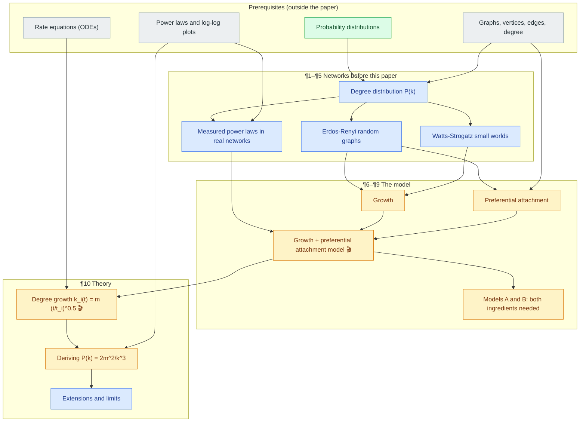
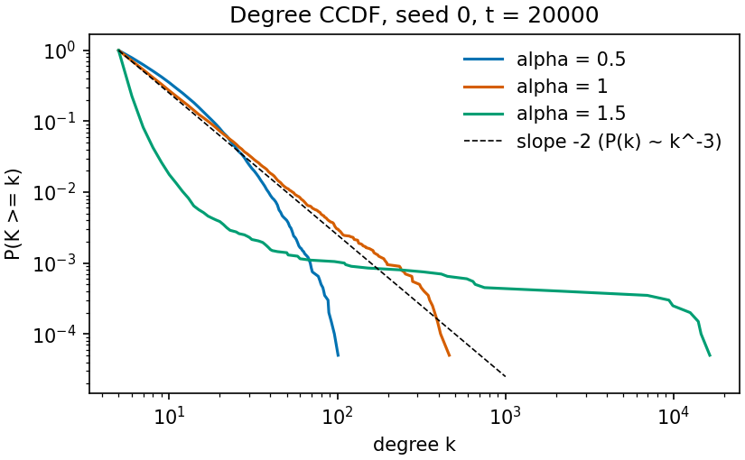

# Emergence of Scaling in Random Networks: concept graph

> **Source:** arXiv:cond-mat/9910332**v1** (October 1999), Albert-László Barabási and Réka Albert. Published in
> *Science* 286, 509 (1999). The published version may differ from this preprint, and all citations here refer to the preprint.
> **Legend:** **not in paper** = common practice, later results or inference, not stated by the authors.
> 🎬 = has an interactive animation. Green nodes = already in your knowledge graph.

**How to cite this paper.** The preprint has no section or equation numbers, so this graph numbers its paragraphs and
equations:

| Label | Where |
|---|---|
| ¶1–¶3 | introduction: "The inability of contemporary science…", "Traditionally…", "In this paper…" |
| ¶4 | real-network data: "While there are a large number of systems…" (Fig. 1) |
| ¶5 | ER and WS models: "The above examples…" |
| ¶6, ¶7 | the two missing ingredients: "There are two generic aspects…", "Second, the random network models…" |
| ¶8 | the model: "We next show that a model…" (Fig. 2A) |
| ¶9 | models A and B: "The development of the power-law scaling…" (Fig. 2B) |
| ¶10 | theory and extensions: "Due to the preferential attachment…" (Fig. 2C) |
| ¶11 | outlook: "Growth and preferential attachment are mechanisms…" |
| E1 | $P(k) \sim k^{-\gamma}$ (¶3) |
| E2 | ER: $P(k) = e^{-\lambda}\lambda^k/k!$ with the paper's expression for $\lambda$ (¶5) |
| E3 | WS at $p = 0$: $P(k) = \delta(k - z)$ (¶5) |
| E4 | $\Pi(k_i) = k_i / \sum_j k_j$ (¶8) |
| E5 | model A: $\Pi(k) = 1/(m_0 + t - 1)$ (¶9) |
| E6 | $\partial k_i/\partial t = k_i/2t$ and $k_i(t) = m(t/t_i)^{0.5}$ (¶10) |
| E7 | $P(k_i(t) < k) = P(t_i > m^2t/k^2) = 1 - m^2t/k^2(t+m_0)$ (¶10) |
| E8 | $P(k) = 2m^2/k^3$, the only displayed equation (¶10) |
| E9 | $\Pi(k) \sim k^\alpha$ and $\gamma(p) = 3 - p$ (¶10) |

## The paper in five lines

1. **Problem:** real networks (actors, the web, citations, power grids) have degree distributions with power-law tails. The standard random-graph models predict exponential tails and no hubs.
2. **Idea:** two ingredients the old models lack: **growth** (vertices keep arriving) and **preferential attachment** (newcomers link to already well-connected vertices).
3. **What's new:** a minimal model with both ingredients, simulations showing it produces a stationary power law, ablations showing both ingredients are needed, and a short continuum calculation giving $\gamma = 3$.
4. **Result:** $P(k) = 2m^2/k^3$, independent of $m$ and of time; simulations give $\gamma = 2.9 \pm 0.1$. Each vertex's degree grows like $\sqrt{t}$ ("rich get richer").
5. **Watch out for:** the unstated starting condition, the continuum (mean-field) shortcuts in the derivation, how exponents are fitted, and a mistyped formula for $\lambda$ in the ER discussion.

## Map

Arrows go from prerequisite to concept.

## Coverage

| Paper item | What it is | Concept(s) |
|---|---|---|
| Abstract | growth + preferential attachment explain scale-free networks | [empirical_scale_free](#empirical_scale_free-measured-power-laws-in-real-networks), [ba_model](#ba_model-the-growth-and-preferential-attachment-model) |
| ¶1–¶2 | complex networks; the Erdős–Rényi tradition | [graphs_and_degree](#graphs_and_degree-graphs-vertices-edges-and-degree), [er_random_graph](#er_random_graph-erdos-renyi-random-graphs) |
| ¶3, E1 | the claim $P(k) \sim k^{-\gamma}$ | [degree_distribution](#degree_distribution-the-degree-distribution-pk), [power_law](#power_law-power-laws-and-log-log-plots) |
| ¶4, Fig. 1, notes 9 and 12 | actor, web, power-grid, citation data | [empirical_scale_free](#empirical_scale_free-measured-power-laws-in-real-networks) |
| ¶5, E2, E3 | ER and WS degree distributions | [er_random_graph](#er_random_graph-erdos-renyi-random-graphs), [ws_small_world](#ws_small_world-watts-strogatz-small-world-networks) |
| ¶6 | growth | [growth](#growth-growth) |
| ¶7 | preferential connectivity | [preferential_attachment](#preferential_attachment-preferential-attachment) |
| ¶8, E4, Fig. 2A | the model, $\gamma_{model} = 2.9 \pm 0.1$, stationarity | [ba_model](#ba_model-the-growth-and-preferential-attachment-model) |
| ¶9, E5, Fig. 2B | models A and B | [ablation_models_a_b](#ablation_models_a_b-models-a-and-b) |
| ¶10, E6, Fig. 2C | rich get richer, $k_i \propto t^{1/2}$ | [degree_growth_law](#degree_growth_law-degree-growth-law) |
| ¶10, E7, E8 | analytic $\gamma = 3$ | [degree_exponent_derivation](#degree_exponent_derivation-deriving-the-degree-exponent) |
| ¶10, E9, note 16 | nonlinear attachment, directed links, random $m$, rewiring | [model_extensions](#model_extensions-extensions-and-limits-of-the-model) |
| ¶11, note 18 | growth + preferential attachment in other systems | [model_extensions](#model_extensions-extensions-and-limits-of-the-model) |

## Concepts (dependency order)

### probability_distribution: Probability distributions

- **Kind:** prerequisite · **already in your knowledge graph** (from *Attention Is All You Need*)
- **Source:** used in ¶3 ($P(k)$) and ¶10 (cumulative probability → density)
- **Depends on:** none

**Intuition.** Non-negative numbers that sum to 1 over the possible outcomes. Here the outcome is "a randomly chosen
vertex has degree $k$". ¶10 also uses the *cumulative* version $P(X < k)$, whose derivative is the density.

$$
P(k) \ge 0,\quad \sum_k P(k) = 1, \qquad P(k) = \frac{\partial}{\partial k} P(X < k) \ \text{(continuous approximation)}
$$

**Nuances and gotchas.**
- Degrees are integers, but ¶10 treats $k$ as continuous so it can differentiate. That's fine for large $k$ and rough near $k = m$.

### graphs_and_degree: Graphs, vertices, edges and degree

- **Kind:** prerequisite
- **Source:** used throughout; the "connectivity" $k_i$ of ¶3–¶10 is the degree

**Intuition.** A network is vertices joined by edges. A vertex's degree $k_i$ is its number of edges. The paper calls it
"connectivity", which is the same thing.

$$
\sum_i k_i = 2E \quad \text{(every edge has two ends)}
$$

**Nuances and gotchas.**
- The identity $\sum_i k_i = 2E$ is what turns "$mt$ edges" into $\sum_j k_j \approx 2mt$ in the derivation.
- The web data in Fig. 1B counts *incoming* links (a directed degree), while the model is undirected.

### power_law: Power laws and log-log plots

- **Kind:** prerequisite
- **Source:** used in ¶3–¶5, ¶8, ¶10, Figs. 1–2

**Intuition.** $P(k) \propto k^{-\gamma}$ looks like a straight line of slope $-\gamma$ on log-log axes. It has no typical
scale: multiplying $k$ by 10 always divides $P$ by $10^\gamma$, so enormous hubs are rare but not absurdly rare.

$$
P(k) \sim k^{-\gamma} \iff \log P(k) \approx -\gamma \log k + c \quad \text{for large } k
$$

**Nuances and gotchas.**
- "$\sim$" means *for large $k$*. Real data only follows the line over a limited range.
- The paper reads $\gamma$ off slopes on log-log plots. Least-squares fits of log-log histograms are biased, and
  maximum-likelihood estimation is now standard (Clauset, Shalizi & Newman, 2009). **not in paper**
- For $\gamma \le 3$ the variance of $k$ grows without bound as the network grows. **not in paper**

**Check yourself.** Why does an exponential tail $e^{-\beta k}$ look curved on a log-log plot but straight on a semi-log plot?

### differential_equations: Rate equations

- **Kind:** prerequisite
- **Source:** used in ¶10 (E6)

**Intuition.** If a quantity grows at a rate proportional to itself divided by time, you can separate variables and integrate.

$$
\frac{dk}{dt} = \frac{k}{2t} \;\Rightarrow\; \frac{dk}{k} = \frac{dt}{2t} \;\Rightarrow\; k = C\,t^{1/2}
$$

**Nuances and gotchas.**
- The initial condition fixes $C$. Here, a vertex arriving at $t_i$ starts with $k = m$.
- Treating integer degrees and discrete time steps as continuous is the *continuum approximation*. It's accurate once $t$ and $k$ are large.

### degree_distribution: The degree distribution P(k)

- **Kind:** core
- **Source:** ¶3 ("the probability $P(k)$ that a vertex in the network interacts with $k$ other vertices"), Figs. 1–2
- **Depends on:** [probability_distribution](#probability_distribution-probability-distributions), [graphs_and_degree](#graphs_and_degree-graphs-vertices-edges-and-degree)
- **Exercise:** `exercises/03_final_scale_free/`

**Intuition.** Pick a vertex at random; $P(k)$ is the chance it has degree $k$. It's the single statistic this whole paper is about.

$$
P(k) = \frac{\#\{\text{vertices with degree } k\}}{N}
$$

| Symbol | Meaning | Units/type |
|---|---|---|
| $k$ | degree | non-negative integer |
| $N$ | number of vertices | integer |
| $\langle k \rangle$ | average degree (Fig. 1 caption) | $2E/N$ |

**Nuances and gotchas.**
- Two networks can share $\langle k \rangle$ and still have completely different $P(k)$. Fig. 1's actor network averages 28.78 but has vertices with thousands of links.

### er_random_graph: Erdos-Renyi random graphs

- **Kind:** core
- **Source:** ¶2, ¶5 (E2), reference 7
- **Depends on:** [degree_distribution](#degree_distribution-the-degree-distribution-pk)

**Intuition.** Take $N$ vertices and connect each pair independently with probability $p$. Every vertex is statistically identical,
so degrees cluster tightly around the mean, and hubs essentially never appear.

$$
P(k) = e^{-\lambda}\frac{\lambda^k}{k!} \quad \text{(Poisson, for large } N \text{ and small } p)
$$

**Nuances and gotchas.**
- **The paper's formula for $\lambda$ is wrong as printed.** It gives $\lambda = N\binom{N-1}{k}p^k(1-p)^{N-1-k}$, but that depends on $k$, so it
  can't be the Poisson parameter. That expression is the expected *number of vertices* with degree $k$. The Poisson
  mean is $\lambda = (N-1)p \approx Np$. **not in paper** (correction)
- Exact degrees are Binomial$(N-1, p)$; Poisson is the large-$N$, fixed-mean limit.
- The number of vertices $N$ is fixed from the start, which is one of the two things ¶6 criticizes.

**Check yourself.** In an ER graph with $N = 10^6$ and average degree 10, roughly how likely is a vertex with degree 100?
Compare with a power law with $\gamma = 3$.

### ws_small_world: Watts-Strogatz small-world networks

- **Kind:** core
- **Source:** ¶5 (E3), reference 10

**Intuition.** Start from a ring where each vertex links to its 2 nearest and 2 next-nearest neighbors ($z = 4$), then rewire each
edge with probability $p$. A few shortcuts make everything close ("six degrees"), but every vertex keeps roughly $z$ links.

$$
p = 0: \; P(k) = \delta(k - z); \qquad p > 0: \; P(k) \text{ peaked around } z, \text{ broader}
$$

**Nuances and gotchas.**
- Short path lengths aren't the same as hubs. WS networks are small-world without being scale-free.
- Like ER, $N$ is fixed, and rewiring picks new endpoints uniformly, with no preference.

### empirical_scale_free: Measured power laws in real networks

- **Kind:** core
- **Source:** ¶4, Fig. 1, notes 9 and 12
- **Depends on:** [degree_distribution](#degree_distribution-the-degree-distribution-pk), [power_law](#power_law-power-laws-and-log-log-plots)

**Intuition.** Very different networks show the same kind of heavy tail:

| Network | $N$ | $\langle k \rangle$ | $\gamma$ |
|---|---|---|---|
| Movie actors (Fig. 1A) | 212,250 | 28.78 | $2.3 \pm 0.1$ |
| Web pages, incoming links (Fig. 1B) | 325,729 | 5.46 | $2.1 \pm 0.1$ |
| Western US power grid (Fig. 1C) | 4,941 | 2.67 | $\simeq 4$ |
| Paper citations (Redner, ref. 11) | — | — | $3$ |

**Nuances and gotchas.**
- The exponents range from 2.1 to 4, but the model predicts exactly 3. ¶10 has to add ingredients to explain the spread.
- The paper itself says the power grid's scaling region is "less prominent" because the network is small. Later work classed the
  power grid's degree distribution as closer to exponential (Amaral et al., 2000). **not in paper**
- Note 12: *C. elegans* (306 vertices) is too small for good statistics, and the chip data had vertices with over 200 edges removed,
  which cuts off the very tail being measured.
- The dashed lines in Fig. 1 are reference slopes, not the result of a reported fitting procedure.

### growth: Growth

- **Kind:** novel
- **Source:** ¶6
- **Depends on:** [er_random_graph](#er_random_graph-erdos-renyi-random-graphs), [ws_small_world](#ws_small_world-watts-strogatz-small-world-networks)

**Intuition.** Real networks are *open*: new actors, pages and papers keep arriving and link to what's already there.
ER and WS instead fix $N$ and only add or rewire edges.

**Nuances and gotchas.**
- Growth alone isn't enough. Model A (growth with uniform attachment) gives an exponential tail (¶9).
- Growth creates an *age* structure: early vertices have had more time to collect links. That's half of the rich-get-richer effect.

### preferential_attachment: Preferential attachment

- **Kind:** novel
- **Source:** ¶7, ¶8 (E4)
- **Depends on:** [er_random_graph](#er_random_graph-erdos-renyi-random-graphs), [graphs_and_degree](#graphs_and_degree-graphs-vertices-edges-and-degree)
- **Animation:** [animations/ba_model.html](animations/ba_model.html)
- **Exercise:** `exercises/01_preferential_attachment/`

**Intuition.** A newcomer links to vertex $i$ with probability proportional to how many links $i$ already has. Popular
actors, pages and papers attract more new connections.

$$
\Pi(k_i) = \frac{k_i}{\sum_j k_j}
$$

| Symbol | Meaning | Type |
|---|---|---|
| $k_i$ | current degree of existing vertex $i$ | integer |
| $\sum_j k_j$ | sum over all existing vertices, $= 2E$ | integer |
| $\Pi(k_i)$ | probability that one new edge lands on $i$ | in $[0, 1]$ |

**Nuances and gotchas.**
- The attachment is *linear* in $k$. ¶10 says simulations only give scaling for $\Pi \sim k^\alpha$ with $\alpha = 1$.
- A vertex with $k = 0$ can never be chosen. That matters for how the model starts (see [ba_model](#ba_model-the-growth-and-preferential-attachment-model)).
- "Link to $m$ **different** vertices" means sampling without replacement, and the paper doesn't say how. The standard reading
  draws targets one at a time, renormalizing $\Pi$ over the vertices not yet picked. **not in paper**
- The same "cumulative advantage" mechanism was proposed for citation networks by Price (1976), and it goes back to
  Yule and Simon. **not in paper**

**Check yourself.** With degrees $[1, 2, 3, 4]$ and $m = 2$, what's the probability the degree-4 vertex is among the two targets?

### ba_model: The growth and preferential attachment model

- **Kind:** novel
- **Source:** ¶8 (E4), Fig. 2A
- **Depends on:** [growth](#growth-growth), [preferential_attachment](#preferential_attachment-preferential-attachment), [empirical_scale_free](#empirical_scale_free-measured-power-laws-in-real-networks)
- **Animation:** [animations/ba_model.html](animations/ba_model.html)
- **Exercise:** `exercises/03_final_scale_free/`

**Intuition.** Start with $m_0$ vertices. Each time step, add one vertex with $m \le m_0$ edges, attached preferentially to existing
vertices. After $t$ steps there are $t + m_0$ vertices and $mt$ edges. The degree distribution settles into a power law that
doesn't change as the network keeps growing.

| Symbol | Meaning | Fig. 2A value |
|---|---|---|
| $m_0$ | starting vertices | 5 |
| $m$ | edges per new vertex | 5 |
| $t$ | time steps (= vertices added) | 150,000 and 200,000 |
| $\gamma_{model}$ | fitted exponent | $2.9 \pm 0.1$ |

**Nuances and gotchas.**
- **The starting edges are never specified.** If the $m_0$ vertices have no edges, every $k_j = 0$ and $\Pi$ is $0/0$ at
  the first step. "$mt$ edges" suggests no starting edges. Implementations start from a small connected graph, often a
  complete graph on $m_0$ vertices. **not in paper**
- "Stationary" means $P(k)$ doesn't depend on $t$ or on system size. That's what lets one model describe networks of very different sizes.
- Simulating naively costs $O(N)$ per step to build $\Pi$. Sampling a uniformly random endpoint from the list of all edge endpoints
  gives probability ∝ degree in $O(1)$. **not in paper**
- Degree depends only on arrival time here. Real hubs can be young (a new site that goes viral), which later "fitness" models add
  (Bianconi & Barabási, 2001). **not in paper**

**Check yourself.** After $t$ steps with a complete-graph start, what is $\sum_j k_j$ exactly? When is $2mt$ a good approximation?

### ablation_models_a_b: Models A and B

- **Kind:** novel
- **Source:** ¶9 (E5), Fig. 2B
- **Depends on:** [ba_model](#ba_model-the-growth-and-preferential-attachment-model)
- **Animation:** [animations/ba_model.html](animations/ba_model.html) (switch attachment to uniform)
- **Exercise:** `exercises/03_final_scale_free/` (model A)

**Intuition.** Remove one ingredient at a time and the power law disappears:

| Model | Growth | Preferential | Result |
|---|---|---|---|
| Full model | ✓ | ✓ | stationary power law, $\gamma \approx 3$ |
| Model A | ✓ | ✗: $\Pi = 1/(m_0 + t - 1)$ | $P(k) \sim e^{-\beta k}$ (Fig. 2B) |
| Model B | ✗: fixed $N$, no edges at start | ✓ | power law at first, never stationary; complete graph after $T \simeq N^2$ |

**Nuances and gotchas.**
- In model A, $m_0 + t - 1$ is the number of vertices present *before* the new one arrives.
- Model B starts with no edges, so the same $0/0$ issue as the full model applies at its first step. **not in paper**
- The same continuum argument for model A gives $k_i(t) = m\,[1 + \ln((m_0 + t - 1)/(m_0 + t_i - 1))]$, so $P(k) \propto e^{-k/m}$.
  That derivation came in follow-up work (Barabási, Albert & Jeong, 1999). **not in paper**

**Check yourself.** Why can't growth alone produce hubs, even though old vertices still end up with more links than young ones?

### degree_growth_law: Degree growth law

- **Kind:** novel
- **Source:** ¶10 (E6), Fig. 2C
- **Depends on:** [ba_model](#ba_model-the-growth-and-preferential-attachment-model), [differential_equations](#differential_equations-rate-equations)
- **Animation:** [animations/degree_growth_law.html](animations/degree_growth_law.html)
- **Exercise:** `exercises/02_derive_degree_exponent/` (worked problem), `exercises/03_final_scale_free/` (measured)

**Intuition.** A vertex's growth rate is proportional to its degree, so every vertex's degree grows like $\sqrt{t}$, and the head start
of early vertices never goes away.

$$
\frac{\partial k_i}{\partial t} = m\,\Pi(k_i) = \frac{m\,k_i}{\sum_j k_j} \approx \frac{k_i}{2t} \quad\Rightarrow\quad k_i(t) = m\left(\frac{t}{t_i}\right)^{1/2}
$$

| Symbol | Meaning | Type |
|---|---|---|
| $t_i$ | time step at which vertex $i$ arrived | integer ≥ 1 |
| $k_i(t_i) = m$ | its degree on arrival | integer |

**Nuances and gotchas.**
- The paper writes $\partial k_i/\partial t = k_i/2t$ directly. The hidden steps are "$m$ edges per step, each landing on $i$ with
  probability $\Pi(k_i)$" and "$\sum_j k_j \approx 2mt$", which ignores the starting edges and holds at large $t$.
- This is a *mean-field* approximation: it tracks the average degree of vertices of a given age. Individual vertices of the
  same age scatter widely around it. **term not in paper**
- Fig. 2C shows only two vertices ($t_1 = 5$, $t_2 = 95$) against a slope-0.5 guide line.

**Check yourself.** Vertex A arrived at step 100 and vertex B at step 400. Roughly what is $k_A / k_B$ much later?

### degree_exponent_derivation: Deriving the degree exponent

- **Kind:** novel
- **Source:** ¶10 (E7, E8)
- **Depends on:** [degree_growth_law](#degree_growth_law-degree-growth-law), [power_law](#power_law-power-laws-and-log-log-plots)
- **Animation:** [animations/degree_growth_law.html](animations/degree_growth_law.html) (last steps)
- **Exercise:** `exercises/02_derive_degree_exponent/` (worked problem)

**Intuition.** Having degree below $k$ is the same as having arrived after a certain time. Arrival times are uniform, so
counting late arrivals gives the cumulative distribution, and differentiating gives $P(k)$.

$$
P(k_i(t) < k) = P\!\left(t_i > \frac{m^2 t}{k^2}\right) = 1 - \frac{m^2 t}{k^2 (t + m_0)} \;\Rightarrow\; P(k) = \frac{\partial P(k_i(t) < k)}{\partial k} = \frac{2m^2 t}{m_0 + t}\,\frac{1}{k^3} \xrightarrow{t \to \infty} \frac{2m^2}{k^3}
$$

**Nuances and gotchas.**
- $\gamma = 3$ doesn't depend on $m$, which only sets the prefactor. The time dependence disappears as $t \to \infty$, which is the
  "stationary" claim in analytic form.
- Sanity check: $\int_m^\infty 2m^2 k^{-3}\,dk = 1$, with minimum degree $m$.
- Simulations give $2.9 \pm 0.1$, not 3, because of finite size, discreteness near $k = m$, and slope fitting on noisy tails.
  The exact discrete solution is $P(k) = \frac{2m(m+1)}{k(k+1)(k+2)}$ (Dorogovtsev, Mendes & Samukhin 2000; Krapivsky, Redner &
  Leyvraz 2000), which behaves like $2m^2/k^3$ only for $k \gg m$. **not in paper**
- A rigorous proof came later (Bollobás, Riordan, Spencer & Tusnády, 2001). **not in paper**

**Check yourself.** Where exactly does the inequality flip, and what goes wrong if you differentiate with respect to $t$ instead of $k$?

### model_extensions: Extensions and limits of the model

- **Kind:** core
- **Source:** ¶10 (E9), note 16, ¶11, note 18
- **Depends on:** [degree_exponent_derivation](#degree_exponent_derivation-deriving-the-degree-exponent)

**Intuition.** The minimal model gives exactly $\gamma = 3$, so it needs tweaks to match real exponents of 2.1–4:

| Change | Claim in the paper |
|---|---|
| Nonlinear attachment $\Pi(k) \sim k^\alpha$ | scaling only for $\alpha = 1$ (simulations) |
| A fraction $p$ of links directed | $\gamma(p) = 3 - p$ (simulations) |
| Random $m$ per new vertex (note 16) | exponent unchanged |
| Adding or removing links between existing vertices | could modify $\gamma$ (no result given) |

**Nuances and gotchas.**
- For $\alpha < 1$ the distribution becomes a stretched exponential. For $\alpha > 1$ a single vertex ends up connected to almost everything
  (Krapivsky, Redner & Leyvraz, 2000). **not in paper**
- ¶11's reach (genetic networks, economic inequality) is speculation, not something the paper tests.

## Open questions and extensions

> From the improvement-ideas pass ([ideas/ideas.md](ideas/ideas.md)). Everything in this section is **not in paper**.

### Does scaling really need α = 1? (idea I-01, tested)

¶10 says, with no details, that simulations show scaling only for $\Pi(k) \sim k^\alpha$ with $\alpha = 1$. We regrew the ¶8 model
($m_0 = m = 5$, $t = 20{,}000$, 3 seeds) and found the same.

| $\alpha$ | Fitted $\gamma$ | Largest degree | What the CCDF looks like |
|---|---|---|---|
| 0.5 | 3.91–4.00 | 90–104 | bends down: lighter than any power law, no hubs |
| 1.0 | 2.92–2.93 | 463–644 | straight, parallel to $k^{-3}$ |
| 1.5 | not meaningful | 16,400–16,812 | one hub linked to 82–84% of all vertices |

The two sides of $\alpha = 1$ break in different ways. Details: [findings](ideas/experiments/01_nonlinear_attachment/findings.md).

### Are the measured power laws really power laws? (idea I-02)

Fig. 1's dashed lines are reference slopes, and the paper doesn't report a fit or a test against other distributions. Two later papers
make this a live question:
- Clauset, Shalizi & Newman (2009) combine maximum-likelihood fits with goodness-of-fit and likelihood-ratio tests.
- Broido & Clauset (2019) apply such tests to nearly 1,000 networks and find strongly scale-free structure rare, with log-normal fits often as good.

These summaries come from the abstracts. Try the test on your own $\alpha = 1$ network first, where you know the answer.

**Check yourself.** Why can a log-normal distribution look like a straight line over two decades on a log-log plot?
