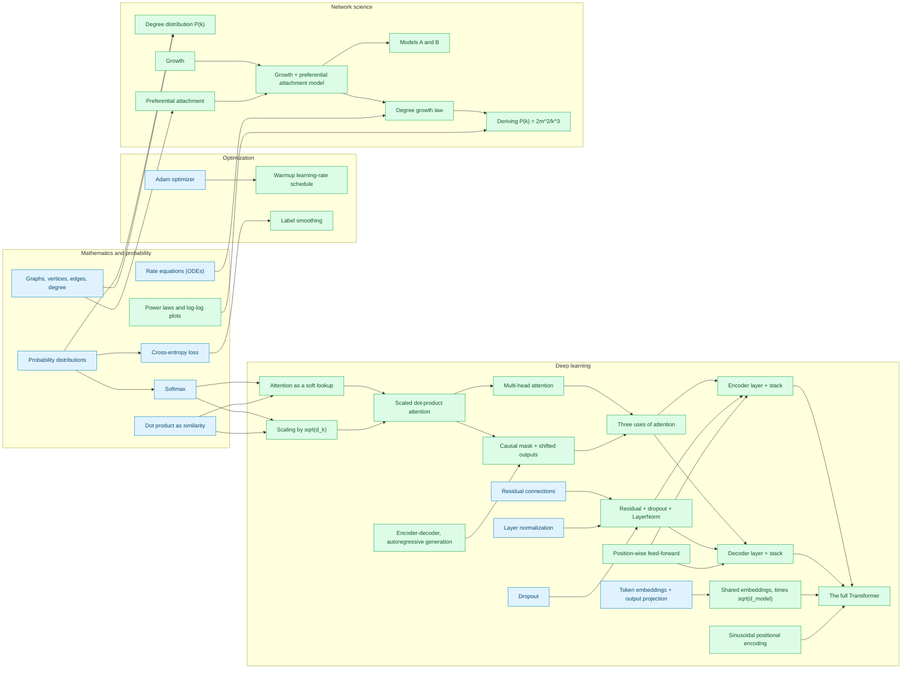

# Knowledge graph

> Maintained by researcher-pal: one map of what you've learned, across all papers.
> **Status:** ✅ learned · 🔶 learning · ☑️ known before (you said so)
> **Last updated:** 2026-09-15
>
> *Example file.* It shows the state after the two example runs in this folder. The learner's step-5 answers are
> simulated, and the reference solutions stand in for the learner's work. A real run writes
> `~/researcher-pal/knowledge_graph.md`.

## Map

Arrows go from prerequisite to topic. Colors show status; boxes group topics by field.

## Topics

| Topic | Status | Field | Papers | Evidence | Updated |
|---|---|---|---|---|---|
| `cross_entropy`: Cross-entropy loss | ☑️ known | Mathematics and probability | [Attention](attention-is-all-you-need/concept_graph.md#cross_entropy-cross-entropy-loss) | said known at start of Attention | 2026-09-15 |
| `differential_equations`: Rate equations | ☑️ known | Mathematics and probability | [Barabási–Albert](barabasi-albert-scaling/concept_graph.md#differential_equations-rate-equations) | said known at start of Barabási–Albert | 2026-09-15 |
| `dot_product`: Dot product as similarity | ☑️ known | Mathematics and probability | [Attention](attention-is-all-you-need/concept_graph.md#dot_product-dot-product-as-similarity) | said known at start of Attention | 2026-09-15 |
| `graphs_and_degree`: Graphs, vertices, edges and degree | ☑️ known | Mathematics and probability | [Barabási–Albert](barabasi-albert-scaling/concept_graph.md#graphs_and_degree-graphs-vertices-edges-and-degree) | said known at start of Barabási–Albert | 2026-09-15 |
| `power_law`: Power laws and log-log plots | ✅ learned | Mathematics and probability | [Barabási–Albert](barabasi-albert-scaling/concept_graph.md#power_law-power-laws-and-log-log-plots) | exercise 03 passed (fitted γ) | 2026-09-15 |
| `probability_distribution`: Probability distributions | ☑️ known | Mathematics and probability | [Attention](attention-is-all-you-need/concept_graph.md#probability_distribution-probability-distributions); [Barabási–Albert](barabasi-albert-scaling/concept_graph.md#probability_distribution-probability-distributions) | said known at start of Attention; reused as known in Barabási–Albert | 2026-09-15 |
| `softmax`: Softmax | ☑️ known | Mathematics and probability | [Attention](attention-is-all-you-need/concept_graph.md#softmax-softmax) | said known at start of Attention | 2026-09-15 |
| `adam`: Adam optimizer | ☑️ known | Optimization | [Attention](attention-is-all-you-need/concept_graph.md#adam-adam-optimizer) | said known at start of Attention | 2026-09-15 |
| `label_smoothing`: Label smoothing | ✅ learned | Optimization | [Attention](attention-is-all-you-need/concept_graph.md#label_smoothing-label-smoothing) | exercise 11 passed | 2026-09-15 |
| `lr_schedule`: Warmup learning-rate schedule | ✅ learned | Optimization | [Attention](attention-is-all-you-need/concept_graph.md#lr_schedule-warmup-learning-rate-schedule) | exercise 10 passed | 2026-09-15 |
| `attention_fn`: Attention as a soft lookup | ✅ learned | Deep learning | [Attention](attention-is-all-you-need/concept_graph.md#attention_fn-attention-as-a-soft-lookup) | covered in exercise 01 (passed) | 2026-09-15 |
| `attention_uses`: Three uses of attention | ✅ learned | Deep learning | [Attention](attention-is-all-you-need/concept_graph.md#attention_uses-three-uses-of-attention) | exercises 07–09 passed | 2026-09-15 |
| `causal_mask`: Causal mask and shifted outputs | ✅ learned | Deep learning | [Attention](attention-is-all-you-need/concept_graph.md#causal_mask-causal-mask-and-shifted-outputs) | exercise 08 passed | 2026-09-15 |
| `decoder_layer`: Decoder layer and stack | ✅ learned | Deep learning | [Attention](attention-is-all-you-need/concept_graph.md#decoder_layer-decoder-layer-and-stack) | exercise 08 passed | 2026-09-15 |
| `dk_scaling`: Scaling by the square root of d_k | ✅ learned | Deep learning | [Attention](attention-is-all-you-need/concept_graph.md#dk_scaling-scaling-by-the-square-root-of-d_k) | exercise 01 passed (scaling test) | 2026-09-15 |
| `dropout`: Dropout | ☑️ known | Deep learning | [Attention](attention-is-all-you-need/concept_graph.md#dropout-dropout) | said known at start of Attention | 2026-09-15 |
| `encoder_decoder`: Encoder-decoder and autoregressive generation | ✅ learned | Deep learning | [Attention](attention-is-all-you-need/concept_graph.md#encoder_decoder-encoder-decoder-and-autoregressive-generation) | exercise 12 passed (greedy decoding) | 2026-09-15 |
| `encoder_layer`: Encoder layer and stack | ✅ learned | Deep learning | [Attention](attention-is-all-you-need/concept_graph.md#encoder_layer-encoder-layer-and-stack) | exercise 07 passed | 2026-09-15 |
| `ffn`: Position-wise feed-forward network | ✅ learned | Deep learning | [Attention](attention-is-all-you-need/concept_graph.md#ffn-position-wise-feed-forward-network) | exercise 03 passed | 2026-09-15 |
| `layer_norm`: Layer normalization | ☑️ known | Deep learning | [Attention](attention-is-all-you-need/concept_graph.md#layer_norm-layer-normalization) | said known at start of Attention | 2026-09-15 |
| `mha`: Multi-head attention | ✅ learned | Deep learning | [Attention](attention-is-all-you-need/concept_graph.md#mha-multi-head-attention) | exercise 02 passed | 2026-09-15 |
| `pos_encoding`: Sinusoidal positional encoding | ✅ learned | Deep learning | [Attention](attention-is-all-you-need/concept_graph.md#pos_encoding-sinusoidal-positional-encoding) | exercise 04 passed | 2026-09-15 |
| `residual`: Residual connections | ☑️ known | Deep learning | [Attention](attention-is-all-you-need/concept_graph.md#residual-residual-connections) | said known at start of Attention | 2026-09-15 |
| `sdpa`: Scaled dot-product attention | ✅ learned | Deep learning | [Attention](attention-is-all-you-need/concept_graph.md#sdpa-scaled-dot-product-attention) | exercise 01 passed | 2026-09-15 |
| `shared_embeddings`: Embeddings, weight tying and scaling | ✅ learned | Deep learning | [Attention](attention-is-all-you-need/concept_graph.md#shared_embeddings-embeddings-weight-tying-and-scaling) | exercises 05 and 09 passed | 2026-09-15 |
| `sublayer`: Residual connection, dropout and LayerNorm | ✅ learned | Deep learning | [Attention](attention-is-all-you-need/concept_graph.md#sublayer-residual-connection-dropout-and-layernorm) | exercise 06 passed | 2026-09-15 |
| `token_embed`: Token embeddings and output projection | ☑️ known | Deep learning | [Attention](attention-is-all-you-need/concept_graph.md#token_embed-token-embeddings-and-output-projection) | said known at start of Attention | 2026-09-15 |
| `transformer`: The full Transformer | ✅ learned | Deep learning | [Attention](attention-is-all-you-need/concept_graph.md#transformer-the-full-transformer) | exercises 09 and 12 passed | 2026-09-15 |
| `ablation_models_a_b`: Models A and B | ✅ learned | Network science | [Barabási–Albert](barabasi-albert-scaling/concept_graph.md#ablation_models_a_b-models-a-and-b) | exercise 03 passed (model A has no hubs) | 2026-09-15 |
| `ba_model`: The growth and preferential attachment model | ✅ learned | Network science | [Barabási–Albert](barabasi-albert-scaling/concept_graph.md#ba_model-the-growth-and-preferential-attachment-model) | exercise 03 passed | 2026-09-15 |
| `degree_distribution`: The degree distribution P(k) | ✅ learned | Network science | [Barabási–Albert](barabasi-albert-scaling/concept_graph.md#degree_distribution-the-degree-distribution-pk) | exercise 03 passed | 2026-09-15 |
| `degree_exponent_derivation`: Deriving the degree exponent | ✅ learned | Network science | [Barabási–Albert](barabasi-albert-scaling/concept_graph.md#degree_exponent_derivation-deriving-the-degree-exponent) | problem 02 accepted | 2026-09-15 |
| `degree_growth_law`: Degree growth law | ✅ learned | Network science | [Barabási–Albert](barabasi-albert-scaling/concept_graph.md#degree_growth_law-degree-growth-law) | problem 02 accepted; exercise 03 measured slope −0.51 | 2026-09-15 |
| `growth`: Growth | ✅ learned | Network science | [Barabási–Albert](barabasi-albert-scaling/concept_graph.md#growth-growth) | exercise 03 passed | 2026-09-15 |
| `preferential_attachment`: Preferential attachment | ✅ learned | Network science | [Barabási–Albert](barabasi-albert-scaling/concept_graph.md#preferential_attachment-preferential-attachment) | exercise 01 passed | 2026-09-15 |

## Papers

| Paper | Folder | Started | Topics learned / concepts in paper |
|---|---|---|---|
| Attention Is All You Need (arXiv 1706.03762v7) | `examples/attention-is-all-you-need/` | 2026-09-15 | 16 learned + 9 known / 31 |
| Emergence of Scaling in Random Networks (arXiv cond-mat/9910332v1) | `examples/barabasi-albert-scaling/` | 2026-09-15 | 8 learned + 3 known / 15 |
